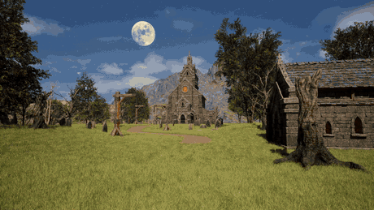

# Necrosylum - Horror Game Prototype

Unreal Engine 5 MVP/prototype.

Instructions for the game:
Visit the shed on the right side when the game loads up. Press E to interact with the door, then you will find a guide note on what to do next.

Playable build is available through the Google Drive link: https://drive.google.com/file/d/1Hbm6U7pZPLmu_2HMrIknjG0qbLGY9knV/view

A comprehensive game design document link: https://docs.google.com/document/d/1YkhG1EaY8058H3wWPDSF7bsnR0ZTLqxsJWaWvm1bF0o/edit?usp=sharing

This project demonstrates level design, environmental interaction, exploration, atmosphere focused design, and a basic playable gameplay loop.
